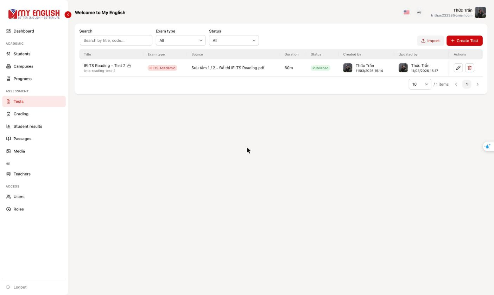
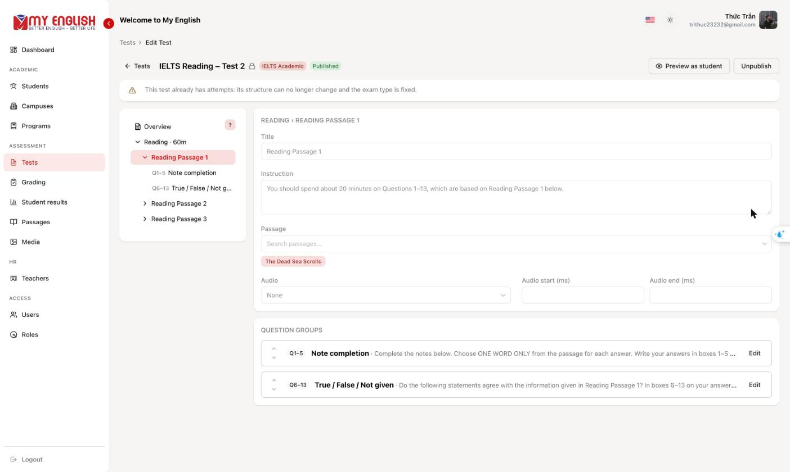
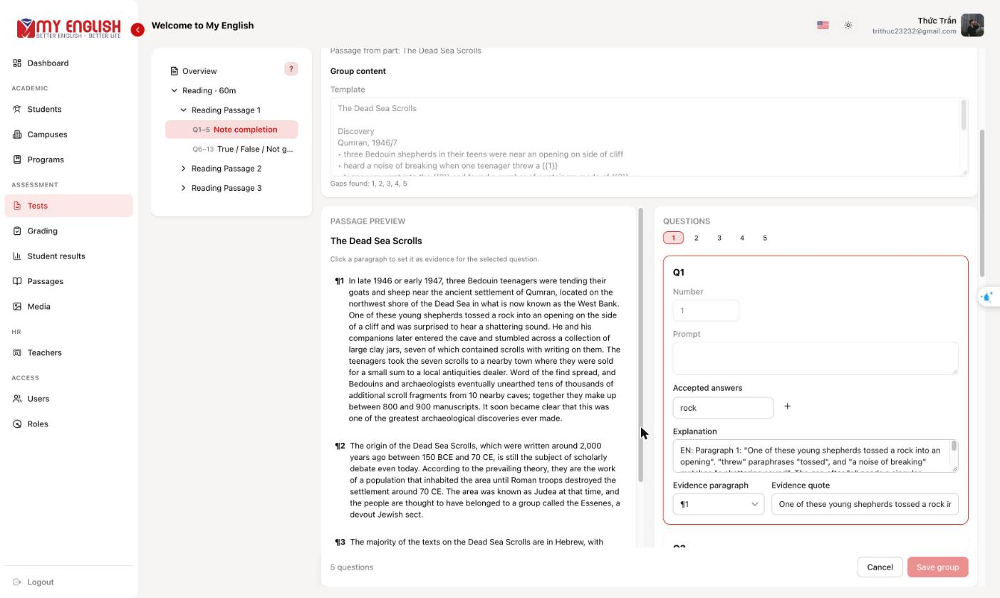
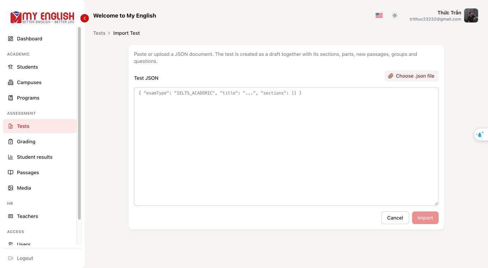
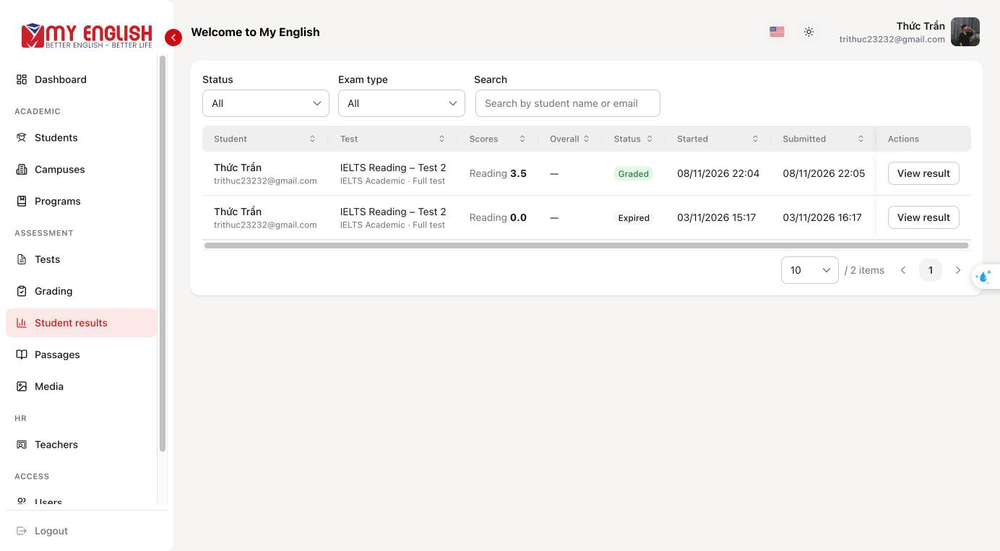
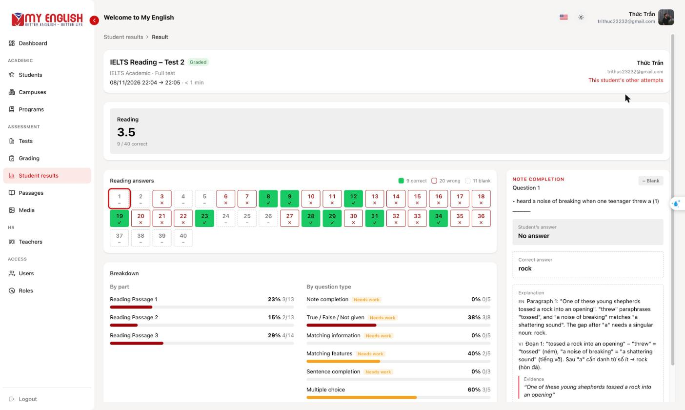
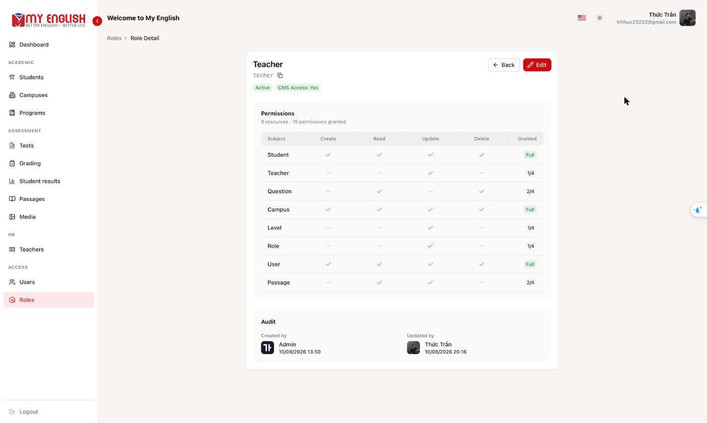
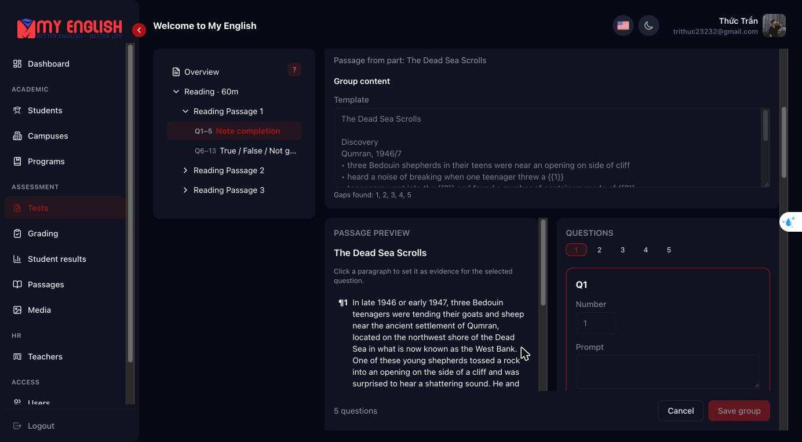
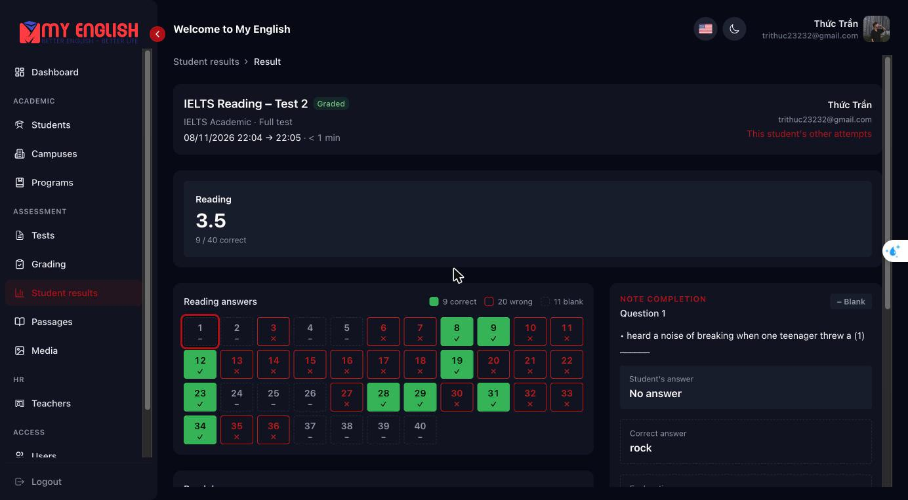

# english-backoffice

The MyEnglish backoffice is the staff web app for building IELTS and TOEIC tests, managing users and permissions, grading Writing and Speaking, and reviewing every student's results.

## The MyEnglish system

| Repo                                            | Role                                                                     | Stack                          |
| ----------------------------------------------- | ------------------------------------------------------------------------ | ------------------------------ |
| [english-service](../english-service/README.md) | REST API, database, scoring, file storage                                | NestJS 12, TypeORM, PostgreSQL |
| **english-backoffice** (this repo)              | Staff CMS: content, users and roles, grading, student results            | React Router 7 SPA, Vite       |
| [english-student](../english-student/README.md) | Student app: test library, exams, results. Also acts as the BFF for auth | Next.js 16                     |

## Screenshots

**Test library and editor.** Tests are edited as a tree (sections → parts → question groups). Each question carries its answers, a bilingual explanation, and a link to the passage paragraph used as evidence.

| Tests                                          | Test tree editor                                 |
| ---------------------------------------------- | ------------------------------------------------ |
|  |  |

| Question group editor                                                | JSON import                                      |
| -------------------------------------------------------------------- | ------------------------------------------------ |
|  |  |

**Student results.** Staff see every student's attempts and the same result view the student gets.

| Student results                                          | Attempt result                                         |
| -------------------------------------------------------- | ------------------------------------------------------ |
|  |  |

**Access control.** Roles grant CASL permissions per resource.



**Dark mode.**

| Question group editor                                                           | Attempt result                                                    |
| ------------------------------------------------------------------------------- | ----------------------------------------------------------------- |
|  |  |

## Features

- **Tests**: create, edit, preview as a student, publish and unpublish IELTS/TOEIC tests. Once a test has attempts, its structure is locked.
- **Test import**: paste or upload a JSON document to create a full draft test.
- **Passages and media**: a reusable passage library, plus audio and image uploads straight to R2 through presigned URLs.
- **Grading** (`/grading`): a queue of IELTS Writing and Speaking sections and a grading screen with per-criterion bands and a live estimated band. Saves send `expectedRevision`, so two teachers can't overwrite each other.
- **Student results** (`/attempts`): every student's attempts, filterable by student, status and exam type, with the full answer breakdown.
- **Administration**: users, roles and permissions, students, teachers, campuses, and programs and levels.
- English and Vietnamese UI, plus light and dark themes.

## Tech stack

React 19 · React Router 7 (framework mode, `ssr: false`) · Vite 8 · HeroUI v3 + Tailwind CSS v4 · TanStack Query and TanStack Table · axios · react-hook-form + yup · CASL · i18next · Vitest + Testing Library · Playwright

## Getting started

```bash
pnpm install
echo "VITE_API_URL=https://api.myenglish.com:8080" > .env
pnpm dev
```

This needs a running [english-service](../english-service/README.md). The API's refresh cookie is `secure` and `sameSite: 'lax'`, so run the backoffice over HTTPS on the same parent domain as the API. If `backoffice.myenglish.com.pem` and `backoffice.myenglish.com-key.pem` (for example from mkcert) are at the repo root, `pnpm dev` serves `https://backoffice.myenglish.com:5173`. Map that host to `127.0.0.1` in `/etc/hosts`.

### Environment variables

| Variable       | Purpose                                           |
| -------------- | ------------------------------------------------- |
| `VITE_API_URL` | API origin; `/api` is appended by the HTTP client |
| `VITE_S3_URL`  | Optional public media base URL                    |

## Scripts

| Command                                              | Description                                                                 |
| ---------------------------------------------------- | --------------------------------------------------------------------------- |
| `pnpm dev`                                           | Dev server (HTTPS when the `.pem` files are present)                        |
| `pnpm build` / `pnpm preview`                        | Production build to `build/` / preview it                                   |
| `pnpm typecheck`                                     | `react-router typegen` + `tsc -b` (run after changing routes)               |
| `pnpm lint` / `pnpm lint:check`                      | oxlint + oxfmt + typecheck / the same without writing changes               |
| `pnpm fmt` / `pnpm fmt:check`                        | oxfmt                                                                       |
| `pnpm test` / `pnpm test:run` / `pnpm test:coverage` | Unit tests (Vitest)                                                         |
| `pnpm e2e`                                           | Playwright against mocked API routes (runs in CI)                           |
| `pnpm e2e:real`                                      | Playwright against a local english-service ([e2e/README.md](e2e/README.md)) |
| `pnpm e2e:ui`                                        | Playwright UI mode                                                          |

## Project structure

```
src/
  routes.ts        every route, declared explicitly (layout / index / route / prefix)
  root.tsx         providers: React Query, theme, locale, toasts
  pages/           route modules per resource: list / create / detail / edit
  components/      shared/ (TanstackTable, ...) and per-feature components
  services/        axios instance + per-resource API modules (services/apis)
  hooks/           React Query hooks (hooks/apis) and form hooks (hooks/forms)
  configs/casl/    ability builder, <Can> and useCan()
  i18n/            translations
  schemas/ types/ utils/ constants/
e2e/               Playwright specs (mock and real projects)
```

To add a page, create the route module under `src/pages/<resource>/` and register it in `src/routes.ts`. Import across features with the `@/` alias.

## CI

On pull requests, CI runs `fmt:check` → `lint` → `typecheck` → `test:run`, plus the mocked Playwright suite.

## Conventions

- Linting and formatting use oxlint and oxfmt. Husky runs lint-staged on commit.
- Commits follow [Conventional Commits](https://www.conventionalcommits.org/) (commitlint).
- `src/utils/attemptResult.ts` is ported from english-student's `lib/results/view.ts`; keep the two in sync.

## Further reading

- [CLAUDE.md](CLAUDE.md): architecture notes
- [e2e/README.md](e2e/README.md): mock and real E2E modes
- [docs/question-formats.md](docs/question-formats.md): question types
