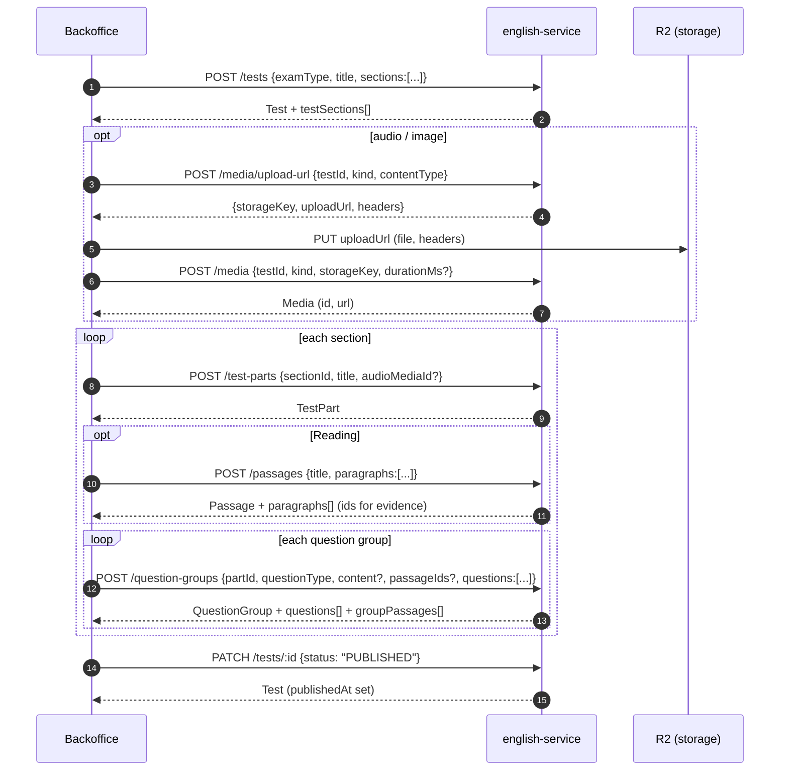

# Test authoring API contract (backoffice)

The contract the backoffice (`client = bo`) uses to build a test end to end: test → sections → parts → question groups → questions, plus the passages that Reading groups link to and the audio/image media that parts, groups and questions reference.

JSON formats for `content` / `answer` / `evidence` are in [`question-formats.md`](./question-formats.md). The DB schema is in [`test-schema.dbml`](./test-schema.dbml). Swagger at `/docs` is generated from the same DTOs.

## 1. Conventions

| Item          | Rule                                                                                                                                                                                              |
| ------------- | ------------------------------------------------------------------------------------------------------------------------------------------------------------------------------------------------- |
| Base URL      | `{API}/api`                                                                                                                                                                                       |
| Auth          | `Authorization: Bearer <access_token>`. The token must be issued to `client = bo`; tokens for other clients get `403`.                                                                            |
| Permissions   | Test tree endpoints use subject `test` (`read` / `create` / `update` / `delete`). Passages use `passage`; paragraphs use `paragraph`; media uses `media`.                                         |
| IDs           | Integers (`number`). User IDs in audit fields are UUID strings.                                                                                                                                   |
| Dates         | ISO 8601 strings.                                                                                                                                                                                 |
| Nullable      | Optional fields come back as `null` when unset.                                                                                                                                                   |
| `order`       | 0-based. When omitted on create, the item goes **last**. When items are sent in an array, `order` defaults to the array index. Use the `reorder` endpoints to move items.                         |
| Bulk delete   | `DELETE /<resource>` with **JSON body** `{ "ids": number[] }` (1–100 ids). With axios: `axios.delete(url, { data: { ids } })`. Response: `{ "deleted": number }`.                                 |
| Pagination    | Only `GET /tests`, `GET /passages` and `GET /media`: `?page=1&take=10` (`take` ≤ 1000). Response: `{ data: T[], meta: { page, take, totalCount } }`.                                              |
| Child lists   | `GET /test-sections`, `/test-parts`, `/question-groups`, `/questions` are **not** paginated: they return a plain array sorted by `order`.                                                         |
| Errors        | Nest default: `{ "statusCode": 400, "message": string \| string[], "error": "Bad Request" }`. DTO validation errors give `message` as an array of strings.                                        |
| Hard vs. soft | Tests and passages are soft-deleted (`status = DELETED`). Sections, parts, groups and questions are hard-deleted and **cascade** to their children. Media is hard-deleted together with its file. |

### Locked tests

`test.lockedAt` is set when the first student attempt is created. Once it is non-null:

- Any create / update / reorder / delete on sections, parts, groups or questions → `400 "Test with ID {id} is locked; its structure can no longer change"`.
- `POST /media/upload-url` and `POST /media` for that test → same `400`.
- `PATCH /tests/:id` still works, but `examType` cannot change.
- `PATCH /questions/:id` only accepts `answer`, `explanation`, `evidence` (to fix a wrong key). Any other field → `400`.

The BO should disable structural editing in the UI when `lockedAt != null`.

## 2. Full flow



Recommended BO screens:

1. **Test form** → `POST /tests` with the sections the exam needs (one call).
2. **Test editor** (tree): sections from `GET /tests/:id`, parts from `GET /test-parts?sectionId=`, groups from `GET /question-groups?partId=`.
   Media pickers list the test's files with `GET /media?testId=&kind=`; uploading a new file follows §5.7.
3. **Group editor**: create the group and all its questions in one `POST /question-groups`; afterwards edit questions individually with `/questions`.
4. **Publish** button → `PATCH /tests/:id { status: "PUBLISHED" }`.

## 3. Enums

```ts
type ExamType = 'IELTS_ACADEMIC' | 'IELTS_GENERAL' | 'TOEIC_LR' | 'TOEIC_SW';
type SkillType = 'LISTENING' | 'READING' | 'WRITING' | 'SPEAKING';
type TestStatus = 'DRAFT' | 'PUBLISHED' | 'DELETED'; // DELETED is never accepted as input
type MarkedBy = 'ALPHABET' | 'NUMBER' | 'NONE';
type MediaKind = 'AUDIO' | 'IMAGE';
type QuestionType =
  /* 30 values, see src/types/test.type.ts and question-formats.md */ string;
```

Skills allowed per exam type (each skill at most once per test):

| examType                          | skills                                |
| --------------------------------- | ------------------------------------- |
| `IELTS_ACADEMIC`, `IELTS_GENERAL` | LISTENING, READING, WRITING, SPEAKING |
| `TOEIC_LR`                        | LISTENING, READING                    |
| `TOEIC_SW`                        | SPEAKING, WRITING                     |

## 4. Response models

```ts
interface UserRef {
  id: string;
  email: string;
  firstName: string | null;
  lastName: string | null;
  avatar: string | null;
}

interface AuditMetadata {
  createdAt: string;
  createdById: string | null;
  updatedAt: string | null;
  updatedById: string | null;
  createdBy: UserRef | null;
  updatedBy: UserRef | null;
}

interface Test {
  id: number;
  examType: ExamType;
  title: string;
  source: string | null;
  durationMinutes: number | null; // overall limit (TOEIC LR = 120)
  status: TestStatus;
  publishedAt: string | null; // set the first time status becomes PUBLISHED
  lockedAt: string | null;
  auditMetadata: AuditMetadata;
  testSections?: TestSection[]; // only on GET /tests/:id, POST, PATCH
}

interface TestSection {
  id: number;
  testId: number;
  skill: SkillType;
  order: number;
  durationMinutes: number | null; // IELTS per-section limit
}

interface TestPart {
  id: number;
  sectionId: number;
  order: number;
  title: string | null;
  instruction: string | null;
  audioMediaId: number | null;
  audioStartMs: number | null;
  audioEndMs: number | null;
}

interface GroupPassage {
  groupId: number;
  passageId: number;
  order: number;
  passage: { id: number; title: string; subtitle: string | null };
}

interface QuestionGroup {
  id: number;
  partId: number;
  order: number;
  questionType: QuestionType;
  instruction: string | null;
  wordLimit: number | null;
  content: object | null; // shape per questionType
  audioMediaId: number | null;
  imageMediaId: number | null;
  groupPassages: GroupPassage[]; // sorted by order
  questions?: Question[]; // only on GET /question-groups/:id, POST, PATCH
}

interface Question {
  id: number;
  groupId: number;
  numberFrom: number;
  numberTo: number;
  order: number;
  prompt: string | null;
  content: object | null; // shape per questionType
  answer: object; // {key} | {keys} | {accepted} | {sample, rubric?}
  explanation: string | null;
  evidence: { paragraphId?: number; quote?: string } | null;
  audioMediaId: number | null;
  imageMediaId: number | null;
  audioStartMs: number | null;
}

interface Passage {
  id: number;
  title: string;
  subtitle: string | null;
  markedBy: MarkedBy;
  status: 'DRAFT' | 'PUBLISHED' | 'DELETED';
  auditMetadata: AuditMetadata;
  paragraphs?: Paragraph[]; // only on detail / create / update
}

interface Paragraph {
  id: number;
  passageId: number;
  content: string;
  order: number;
}

interface Media {
  id: number;
  testId: number; // owning test; the file lives under tests/{testId}/
  kind: MediaKind;
  storageKey: string; // tests/{testId}/{audio|image}/{uuid}.{ext}
  url: string; // public CDN URL, built from storageKey
  mimeType: string | null;
  sizeBytes: string | null; // bigint as a string
  durationMs: number | null; // AUDIO, sent by the BO
  transcript: string | null;
  auditMetadata: Omit<AuditMetadata, 'createdBy' | 'updatedBy'>;
}
```

Parts, groups and questions only return `audioMediaId` / `imageMediaId`; fetch the file URL with `GET /media/:id` (or from the `GET /media?testId=` list).

## 5. Endpoints

### 5.1 Tests — `/tests`

| Method | Path         | Body / query                        | Response          |
| ------ | ------------ | ----------------------------------- | ----------------- |
| GET    | `/tests`     | `?page&take&search&status&examType` | `Paginated<Test>` |
| GET    | `/tests/:id` | —                                   | `Test` + sections |
| POST   | `/tests`     | `CreateTestBody`                    | `Test` + sections |
| PATCH  | `/tests/:id` | `UpdateTestBody`                    | `Test` + sections |
| DELETE | `/tests`     | `{ ids }`                           | `{ deleted }`     |

`search` matches `title` or `source` (case-insensitive). List is sorted by `createdAt DESC` and does not include sections.

```ts
interface CreateTestBody {
  examType: ExamType;
  title: string; // 1..255
  source?: string; // ≤255, e.g. "Cambridge 18"
  durationMinutes?: number; // ≥1
  sections?: Array<{
    skill: SkillType;
    order?: number; // defaults to array index
    durationMinutes?: number; // ≥1
  }>;
}

// Sections are not editable here; use /test-sections
interface UpdateTestBody {
  examType?: ExamType; // re-validated against existing sections; blocked when locked
  title?: string;
  source?: string;
  durationMinutes?: number;
  status?: 'DRAFT' | 'PUBLISHED';
}
```

```http
POST /api/tests
{
  "examType": "IELTS_ACADEMIC",
  "title": "Cambridge IELTS 18 - Test 1",
  "source": "Cambridge 18",
  "sections": [
    { "skill": "LISTENING", "durationMinutes": 30 },
    { "skill": "READING", "durationMinutes": 60 }
  ]
}
```

Errors: `400` skill not allowed for the exam type / duplicate skill; `404` test not found.

### 5.2 Sections — `/test-sections`

| Method | Path                     | Body / query                                  | Response        |
| ------ | ------------------------ | --------------------------------------------- | --------------- |
| GET    | `/test-sections`         | `?testId` (required)                          | `TestSection[]` |
| GET    | `/test-sections/:id`     | —                                             | `TestSection`   |
| POST   | `/test-sections`         | `{ testId, skill, order?, durationMinutes? }` | `TestSection`   |
| PATCH  | `/test-sections/:id`     | `{ skill?, order?, durationMinutes? }`        | `TestSection`   |
| PATCH  | `/test-sections/reorder` | `{ testId, ids }`                             | `TestSection[]` |
| DELETE | `/test-sections`         | `{ ids }`                                     | `{ deleted }`   |

Errors: `409` the test already has that skill; `400` skill not allowed for the exam type; `400` locked.

### 5.3 Parts — `/test-parts`

| Method | Path                  | Body / query            | Response      |
| ------ | --------------------- | ----------------------- | ------------- |
| GET    | `/test-parts`         | `?sectionId` (required) | `TestPart[]`  |
| GET    | `/test-parts/:id`     | —                       | `TestPart`    |
| POST   | `/test-parts`         | `CreatePartBody`        | `TestPart`    |
| PATCH  | `/test-parts/:id`     | `UpdatePartBody`        | `TestPart`    |
| PATCH  | `/test-parts/reorder` | `{ sectionId, ids }`    | `TestPart[]`  |
| DELETE | `/test-parts`         | `{ ids }`               | `{ deleted }` |

```ts
interface CreatePartBody {
  sectionId: number;
  order?: number;
  title?: string; // ≤255, "Part 1" / "Passage 2"
  instruction?: string;
  audioMediaId?: number; // must be AUDIO media (IELTS Listening: one audio per part)
  audioStartMs?: number; // ≥0, for parts sharing one audio file
  audioEndMs?: number; // must be > audioStartMs
}
type UpdatePartBody = Partial<Omit<CreatePartBody, 'sectionId'>>;
```

Errors: `400` `audioEndMs must be after audioStartMs`; `400` `Media with ID {id} not found` / `is IMAGE, expected AUDIO`.

### 5.4 Question groups — `/question-groups`

| Method | Path                       | Body / query         | Response                              |
| ------ | -------------------------- | -------------------- | ------------------------------------- |
| GET    | `/question-groups`         | `?partId` (required) | `QuestionGroup[]` (no `questions`)    |
| GET    | `/question-groups/:id`     | —                    | `QuestionGroup` + questions (answers) |
| POST   | `/question-groups`         | `CreateGroupBody`    | `QuestionGroup` + questions           |
| PATCH  | `/question-groups/:id`     | `UpdateGroupBody`    | `QuestionGroup` + questions           |
| PATCH  | `/question-groups/reorder` | `{ partId, ids }`    | `QuestionGroup[]`                     |
| DELETE | `/question-groups`         | `{ ids }`            | `{ deleted }`                         |

```ts
interface CreateGroupBody {
  partId: number;
  order?: number;
  questionType: QuestionType;
  instruction?: string; // "Questions 1-6: Do the following statements agree..."
  wordLimit?: number; // ≥1, "NO MORE THAN TWO WORDS" -> 2
  content?: object; // required for some types, forbidden for others (question-formats.md)
  audioMediaId?: number; // AUDIO (TOEIC Part 3/4)
  imageMediaId?: number; // IMAGE (graphic, map, diagram)
  passageIds?: number[]; // ≤3, unique, display order = array order
  questions?: QuestionInput[]; // ≤100, created in the same transaction
}

// passageIds, when sent, REPLACES all links ([] removes them). questions can't be sent here.
type UpdateGroupBody = Partial<Omit<CreateGroupBody, 'partId' | 'questions'>>;
```

Changing `questionType` re-validates the group `content` and every existing question's `content`/`answer` against the new type; any mismatch → `400` and nothing is saved. In practice: send the new `questionType` together with a matching `content`, and delete/fix incompatible questions first.

Example — IELTS Reading, TRUE/FALSE/NOT GIVEN linked to a passage:

```http
POST /api/question-groups
{
  "partId": 12,
  "questionType": "TRUE_FALSE_NOT_GIVEN",
  "instruction": "Questions 1-6: Do the following statements agree with the information given in Reading Passage 1?",
  "passageIds": [34],
  "questions": [
    { "numberFrom": 1, "prompt": "The first cars were built in 1886.", "answer": { "key": "TRUE" },
      "evidence": { "paragraphId": 501, "quote": "In 1886, Karl Benz..." } },
    { "numberFrom": 2, "prompt": "Benz worked alone.", "answer": { "key": "NOT GIVEN" } }
  ]
}
```

Example — IELTS Listening, form completion:

```http
POST /api/question-groups
{
  "partId": 10,
  "questionType": "FORM_COMPLETION",
  "instruction": "Complete the form below. Write ONE WORD AND/OR A NUMBER for each answer.",
  "wordLimit": 1,
  "content": { "template": "Name: Sarah {{1}}\nPostcode: {{2}}" },
  "questions": [
    { "numberFrom": 1, "answer": { "accepted": ["Brown"] } },
    { "numberFrom": 2, "answer": { "accepted": ["DW30 7YZ"] } }
  ]
}
```

Example — "Choose TWO" (one question row worth 2 points):

```json
{
  "numberFrom": 21,
  "numberTo": 22,
  "prompt": "Which TWO ...?",
  "content": {
    "options": [
      { "key": "A", "text": "..." },
      { "key": "B", "text": "..." },
      { "key": "C", "text": "..." }
    ]
  },
  "answer": { "keys": ["A", "C"] }
}
```

Errors: `400` invalid `content` / `answer` / `evidence` (message names the question number and the expected shape); `400` `One or more passages not found`; `400` media kind mismatch.

### 5.5 Questions — `/questions`

| Method | Path                 | Body / query          | Response      |
| ------ | -------------------- | --------------------- | ------------- |
| GET    | `/questions`         | `?groupId` (required) | `Question[]`  |
| GET    | `/questions/:id`     | —                     | `Question`    |
| POST   | `/questions`         | `CreateQuestionBody`  | `Question`    |
| PATCH  | `/questions/:id`     | `UpdateQuestionBody`  | `Question`    |
| PATCH  | `/questions/reorder` | `{ groupId, ids }`    | `Question[]`  |
| DELETE | `/questions`         | `{ ids }`             | `{ deleted }` |

```ts
interface QuestionInput {
  numberFrom: number; // ≥1, displayed question number
  numberTo?: number; // defaults to numberFrom; > numberFrom only with answer {keys}
  order?: number;
  prompt?: string;
  content?: object; // shape per group questionType
  answer: object; // required
  explanation?: string;
  evidence?: { paragraphId?: number; quote?: string };
  audioMediaId?: number; // AUDIO (TOEIC Part 1/2 clip)
  imageMediaId?: number; // IMAGE (TOEIC Part 1 photo)
  audioStartMs?: number; // review: jump to the answer
}
type CreateQuestionBody = QuestionInput & { groupId: number };
type UpdateQuestionBody = Partial<QuestionInput>; // locked test: only answer/explanation/evidence
```

### 5.6 Passages & paragraphs (Reading content)

Passages are a shared library, created before the group that links to them. Create the paragraphs together with the passage, then use the returned `paragraphs[].id` for `evidence.paragraphId`.

| Method | Path                  | Body / query                                       | Response               |
| ------ | --------------------- | -------------------------------------------------- | ---------------------- |
| GET    | `/passages`           | `?page&take&search&status&markedBy`                | `Paginated<Passage>`   |
| GET    | `/passages/:id`       | —                                                  | `Passage` + paragraphs |
| POST   | `/passages`           | `{ title, subtitle?, markedBy?, paragraphs? }`     | `Passage` + paragraphs |
| PATCH  | `/passages/:id`       | same fields + `status?`; `paragraphs` replaces all | `Passage` + paragraphs |
| DELETE | `/passages`           | `{ ids }`                                          | `{ deleted }`          |
| GET    | `/paragraphs`         | `?passageId&page&take`                             | `Paginated<Paragraph>` |
| POST   | `/paragraphs`         | `{ passageId, content, order? }`                   | `Paragraph`            |
| PATCH  | `/paragraphs/:id`     | `{ content?, order? }`                             | `Paragraph`            |
| PATCH  | `/paragraphs/reorder` | `{ passageId, ids }`                               | `Paragraph[]`          |
| DELETE | `/paragraphs`         | `{ ids }`                                          | `{ deleted }`          |

`paragraphs` items: `{ content: string; order?: number }` (≤500). Because `PATCH /passages/:id` with `paragraphs` replaces the list, paragraph IDs change — any `evidence.paragraphId` pointing at the old ones goes stale. Prefer `/paragraphs` for editing a passage that is already linked to questions.

### 5.7 Media — `/media`

Files are uploaded straight to R2 with a presigned URL; the API never receives the bytes. Every media belongs to one test and is stored at `tests/{testId}/{audio|image}/{uuid}.{ext}`.

| Method | Path                | Body / query                   | Response           |
| ------ | ------------------- | ------------------------------ | ------------------ |
| POST   | `/media/upload-url` | `UploadUrlBody`                | `UploadUrlResult`  |
| POST   | `/media`            | `CreateMediaBody`              | `Media`            |
| GET    | `/media`            | `?page&take&testId&kind`       | `Paginated<Media>` |
| GET    | `/media/:id`        | —                              | `Media`            |
| PATCH  | `/media/:id`        | `{ durationMs?, transcript? }` | `Media`            |
| DELETE | `/media/:id`        | —                              | `{ deleted: 1 }`   |

```ts
interface UploadUrlBody {
  testId: number;
  kind: MediaKind;
  contentType: string; // see allowed types below
}

interface UploadUrlResult {
  storageKey: string; // pass back to POST /media
  uploadUrl: string; // presigned PUT
  headers: { 'Content-Type': string; 'Cache-Control': string }; // send exactly these on the PUT
  expiresIn: number; // seconds (default 600)
}

interface CreateMediaBody {
  testId: number; // same as in upload-url
  kind: MediaKind; // same as in upload-url
  storageKey: string;
  durationMs?: number; // ≥0, read from the <audio> element before upload
  transcript?: string;
}
```

Upload steps:

1. `POST /media/upload-url` → `{ storageKey, uploadUrl, headers }`.
2. `PUT uploadUrl` with the file as the body and **exactly** the returned `headers` (a different `Content-Type` is rejected by R2 with `403`). No `Authorization` header.
3. `POST /media` with the `storageKey` → `Media`. Use `media.id` as `audioMediaId` / `imageMediaId`.

```ts
const { storageKey, uploadUrl, headers } = await api.post('/media/upload-url', {
  testId,
  kind: 'AUDIO',
  contentType: file.type,
});
await fetch(uploadUrl, { method: 'PUT', body: file, headers });
const media = await api.post('/media', {
  testId,
  kind: 'AUDIO',
  storageKey,
  durationMs,
});
```

| kind    | Allowed `contentType`                                             | Max size |
| ------- | ----------------------------------------------------------------- | -------- |
| `AUDIO` | `audio/mpeg`, `audio/mp4`, `audio/ogg`, `audio/webm`, `audio/wav` | 100 MB   |
| `IMAGE` | `image/jpeg`, `image/png`, `image/webp`, `image/avif`             | 10 MB    |

`GET /media` is sorted by `id DESC`. Files are cached by the CDN as immutable: to replace a file, upload a new media and point the part/group/question at it, then delete the old one.

Errors:

- `POST /media/upload-url`: `400` content type not allowed for the kind; `404` test not found; `400` test locked.
- `POST /media`: `400` `Invalid storage key` / `Storage key does not belong to {kind} of test {testId}`; `400` `File has not been uploaded` (PUT missing or URL expired); `400` file too large or wrong type — the uploaded object is deleted, request a new upload URL; `409` `Storage key is already registered`; `404` / `400` test not found / locked.
- `DELETE /media/:id`: `404`; `409` `Media with ID {id} is in use` — detach it from every part/group/question first.

### 5.8 Reorder (all child resources)

`PATCH /<resource>/reorder` with `{ <parentId>, ids }`. `ids` must contain **every** child of that parent exactly once, in the new order; the server rewrites `order` to `0..n-1` and returns the sorted list.

- `400 One or more ... do not belong to this ...` — an id from another parent.
- `400 ids must include all N ...` — missing ids.

## 6. Exam-specific guidance

| Exam / section  | Parts                                | Groups / questions                                                                                                                                                                 |
| --------------- | ------------------------------------ | ---------------------------------------------------------------------------------------------------------------------------------------------------------------------------------- |
| IELTS Listening | 4 parts, `audioMediaId` on each part | Q1–40, any IELTS question type                                                                                                                                                     |
| IELTS Reading   | 3 parts ("Passage 1..3")             | Q1–40; each group links its passage via `passageIds: [id]`                                                                                                                         |
| TOEIC Listening | Parts 1–4                            | P1 `PHOTO_DESCRIPTION` (question `imageMediaId` + `audioMediaId`); P2 `QUESTION_RESPONSE`; P3/4 `MULTIPLE_CHOICE` groups with group `audioMediaId` (+ `imageMediaId` for graphics) |
| TOEIC Reading   | Parts 5–7                            | P5 `MULTIPLE_CHOICE`; P6 `TEXT_COMPLETION` + `passageIds: [id]`; P7 `MULTIPLE_CHOICE` + `passageIds` (1–3)                                                                         |

Question numbers must be continuous across the whole test (1..40 IELTS, 1..200 TOEIC LR) with no duplicates. **This is not checked by the API yet** (see §7) — the BO should validate it before publishing.

## 7. Known gaps (BE work needed before the BO flow is complete)

1. **Media is not checked against the test.** Parts, groups and questions only check that `audioMediaId` / `imageMediaId` exist and have the right kind, not that `media.testId` is the same test. The BO should only offer media from `GET /media?testId={current test}`. Responses also carry only the ids, not the media `url`.
2. **No full-tree read.** Rendering the editor costs one request per level (`/tests/:id` → `/test-parts` per section → `/question-groups` per part → `/question-groups/:id` per group for questions). A `GET /tests/:id/tree` (or `?include=tree`) would remove the N+1.
3. **Publish does not validate.** `PATCH /tests/:id { status: "PUBLISHED" }` only flips the status. Planned checks (continuous numbering, `{{n}}` placeholders matching `numberFrom`, every section has at least one question, Listening parts have audio) do not exist yet.
4. **`lockedAt` is never set** — attempts are not implemented, so the locked rules in §1 do not trigger yet.
5. **Unknown body fields are not stripped.** The global `ValidationPipe` has no `whitelist`, and services spread the DTO into `update()`/`save()`. A body like `PATCH /test-parts/:id { "sectionId": 99 }` or `PATCH /tests/:id { "lockedAt": null }` is written to the DB. The BO should only send documented fields; the BE should enable `whitelist: true, forbidNonWhitelisted: true`.
